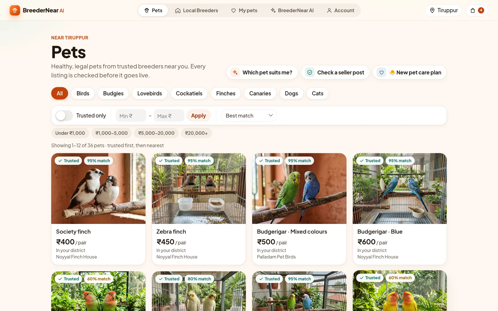
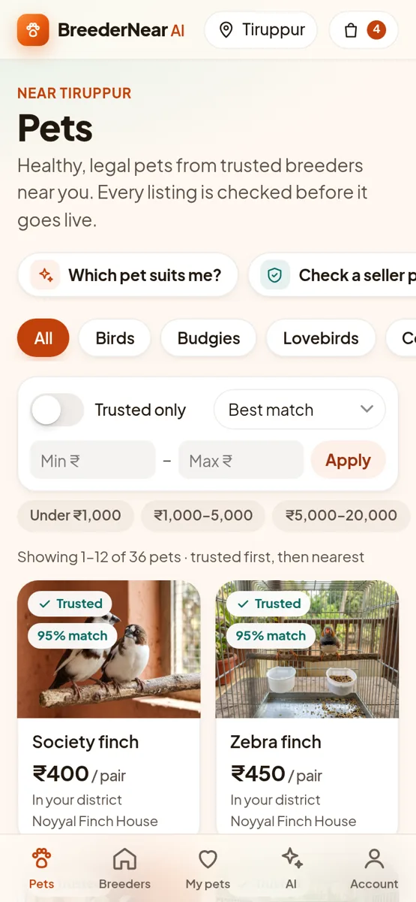
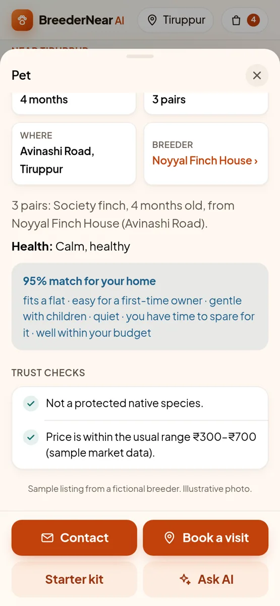
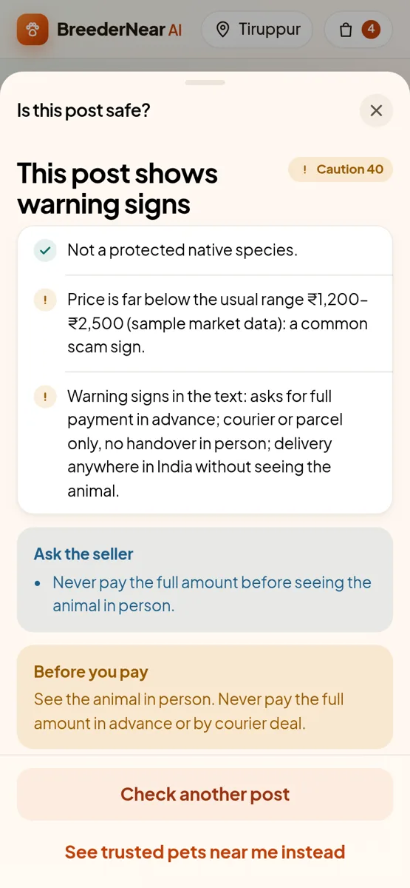
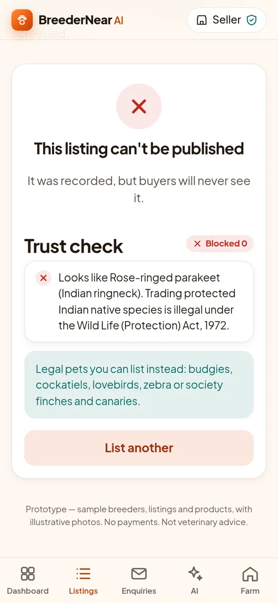
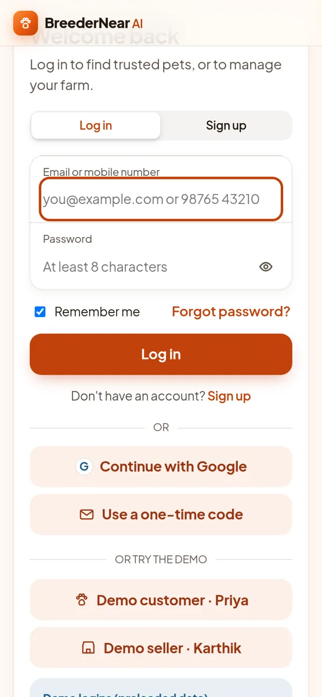
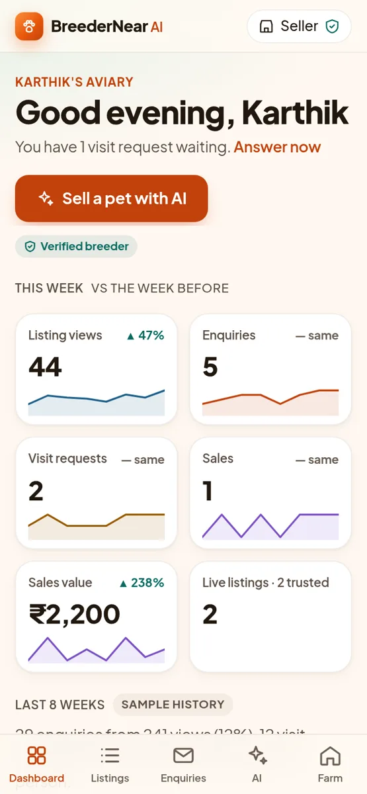
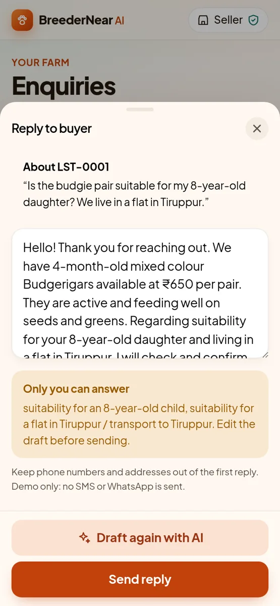
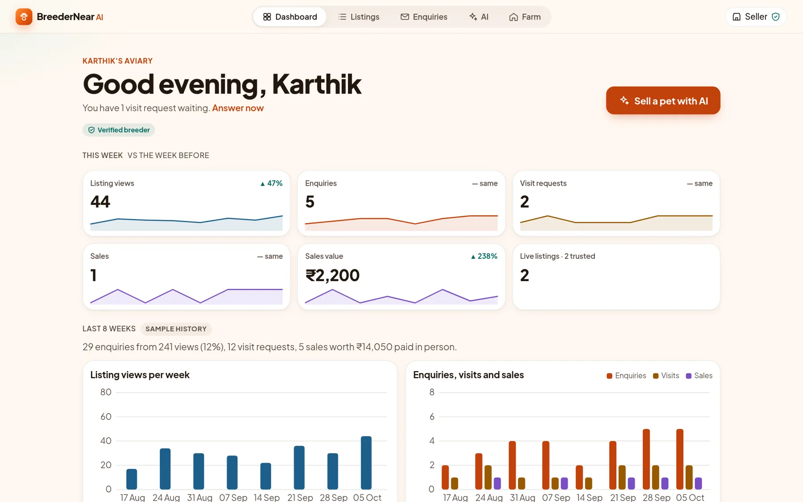
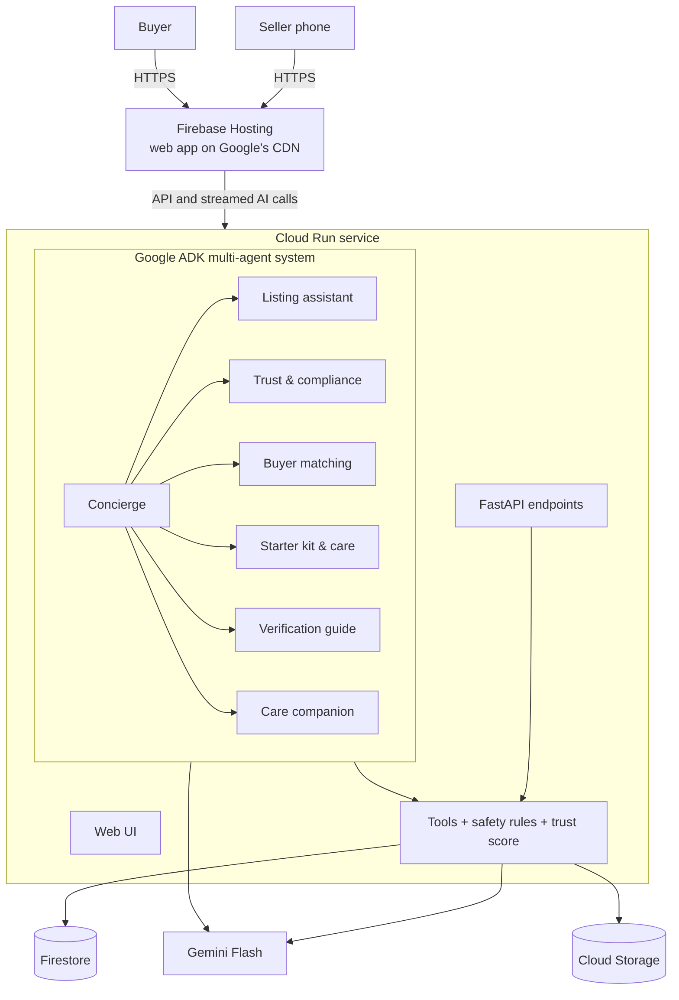

# BreederNear AI 🐾

### Find the trusted breeder next door: AI agents for safe, fair, direct pet commerce

**Google Cloud AI Builder Cup 2026 (JAPAC) · Theme: Retail & Commerce**

**Live demo:** https://breedernear-ai-2026.web.app (Firebase Hosting) or https://breedernear-655711985039.asia-south1.run.app (Cloud Run) · demo video: added at submission (18 Oct 2026)

> This README describes only what is built. Future ideas are listed under [Roadmap](#roadmap).

<p>

</p>

<p>




</p>

---

## The problem

> **"The breeder is 50 metres away. The customer never finds them."**

Our founder spent five years as a bird breeder and broker in Coimbatore, India. Over and over he saw the same thing:

- **New buyers walk into a pet shop and overpay**, often for a less healthy animal, because the breeder down the street is invisible online.
- **The real market is hidden on social media** (WhatsApp, Instagram and Facebook groups), visible only to insiders. None of them is a dedicated, trusted marketplace for pets, and nothing is checked.
- **Buyers can't tell good sellers from bad.** Scams are common, and protected native birds are still traded illegally, sometimes dyed to disguise them.
- **Breeders lose hours every day** to manual selling: repeating answers, confirming stock, negotiating.

## Try it: demo accounts with preloaded data

| Account | Login | Password | What's already there |
|---|---|---|---|
| Customer | `priya.customer@example.com` | `demo12345` | District Tiruppur, 2 enquiries sent, a budgie starter kit in the cart |
| Seller | `karthik.seller@example.com` | `demo12345` | Karthik's Aviary (Coimbatore): 4 listings with photos (2 live, 1 paused, 1 sold), views, 4 buyer enquiries |

Or tap **Demo customer** / **Demo seller** on the login screen. These are shared demo accounts with sample data only; they can't be deleted or renamed, and their sample listings can't be removed.

### See it in 2 minutes

1. **Demo customer · Priya** → **Pets**: trusted pets near Tiruppur with fair-price bars. Open one: trust checks, questions to ask, **Starter kit** (cage sized for the animals) and a 14-day care plan.
2. **Pets → "Check a seller post"** → paste `Lovebirds pair 500 only!! Full advance GPay, courier only, all India delivery` → **CAUTION** with the reasons.
3. **BreederNear AI** tab → ask `I want an Indian parrot that talks` → refused, with legal alternatives.
4. Log out → **Demo seller · Karthik** → **Dashboard** → **Sell a pet with AI** → type `pachai kili kunjugal virpanaikku, 2 for 800, Kovai` → **Fill with AI** → **Publish** → **BLOCKED** (protected species, decided in code). Then try `4 jodi lutino lovebird, 5 maasam, oru jodi 1800 rubai, Kovai` → published.
5. **Enquiries** → **Reply** → **✨ Draft with AI**: a reply written from the listing's facts, with what only the seller can answer flagged. Send it, then see it as Priya under **Account**.

<p>



</p>

<p>

</p>

## One app, two kinds of account

Customers and sellers have **separate accounts**: email or mobile + password, a one-time code (new accounts), Continue with Google (Firebase Authentication), or one-tap demo accounts for judges. Customers get the buyer app; sellers get a seller dashboard. The server checks the role on every request, including inside the AI agents' tools.

## The customer app

| Tab | For | What you can do |
|---|---|---|
| 🐾 **Pets** | Buyers | Browse pets near you with a **match %** for your home, filter by species, price and trust; open a listing to see every trust check; message the breeder (AI drafts the first message), **book a visit**; get a starter kit and care plan; take the "Which pet suits me?" quiz; check a post you saw on social media and share the warning; see **Impact so far** |
| 🏡 **Local Breeders** | Buyers | **Direct Farm:** meet breeders near you and buy at the farm price, with no broker markup |
| ❤️ **My pets** | Buyers | After "I bought this pet": a daily log with AI feedback and a streak, a growth tracker against typical weights, a vaccination and deworming calendar, and a symptom checker that says how urgently to see a vet (never medicines or doses) |
| ✨ **BreederNear AI** | Buyers | Ask in English or Tamil. Seven Gemini agents find a pet, check a post, book a visit or help care for it, and show what they did |
| 👤 **Account** | Buyers | My home and family (match %), visits ("I bought this pet"), enquiries and replies, cart, district, log out, delete account |

## The seller app

| Tab | What sellers can do |
|---|---|
| 📊 **Dashboard** | Last-7-days cards with trends (views, enquiries, visit requests, sales, sales value, live listings); a nudge such as a visit waiting; a getting-started checklist for new sellers; **8-week charts** (views, enquiries, visits, sales, view-to-sale funnel, sales by species); recent activity; Impact so far; "Sell a pet with AI" |
| 📋 **Listings** | Add photos and a quick message or a **voice note** (English or Tamil), tap "✨ Fill with AI", check the form, add a vaccination card (optional), publish with a trust check; pause, mark sold or remove |
| ✉️ **Enquiries** | **Visit requests** to confirm or decline; messages from buyers, with scam warnings. Tap Reply → "✨ Draft with AI" writes an answer from your listing's facts; you edit and send |
| ✨ **AI** · 🏡 **Farm** | The listing and verification assistants by chat; farm profile and **breeder verification** (phone code, facility photos checked by Gemini, dog-breeder certificate; no ID documents) for the Verified breeder badge |

Everything works by tapping; the AI does the hard parts on every screen. Chat is there when you'd rather just ask.

## What BreederNear AI does

| Step | What happens | How |
|---|---|---|
| **List** | A breeder sends photos plus a casual message, typed **or spoken as a voice note**, the way they'd post on social media, in English or Tamil. They get a complete, priced listing ready to publish. | Gemini multimodal (photos **and audio**) and multilingual extraction into a validated schema; Gemini hears the voice note directly, no separate speech-to-text; fair-price range from data |
| **Check** | Every listing is screened before buyers see it. Protected species are **blocked**. Dyed birds, visible health concerns, reused photos, suspicious prices and scam language are flagged. Buyers see an explainable trust score. | Gemini vision + deterministic rules (perceptual hashing, price rules, species lists) → trust score **computed in code** |
| **Find** | A buyer browses nearby pets, takes a short quiz or describes their home, family and budget. BreederNear suggests suitable pets and finds trusted breeders nearby, with fair-price indicators. | Rules + ADK agent with tool calls over Firestore; distance by district |
| **Start right** | A personalised starter kit (correct cage size, food, accessories) and a first-14-days care plan with "see a vet if…" signs | Product rules + Gemini structured care plans |
| **Is this listing safe?** | Upload a screenshot of a post seen on social media and get the same trust screening. **Share this warning** sends the reasons back to the group where the post was seen; a protected species shows how to **report it** (Tamil Nadu's wildlife-crime complaint portal); a scam shows the 1930 cyber-fraud helpline | Same pipeline, nothing stored (only a count) |
| **Meet and buy** | A match % for every pet, an AI-drafted first message, a scam shield on messages, visit booking, and "I bought this pet" after a confirmed visit (paid in person, never in the app) | Match % computed in code from the quiz rules; Gemini drafts and scans text |
| **Care** | A care companion for the pet at home: daily log, growth, health calendar, symptom urgency | Gemini feedback and triage; weight ranges, calendar and an emergency floor in code |
| **Verify** | Breeders earn a Verified breeder badge | Gemini reads facility photos and certificates; pass/fail rules in code; photos deleted once read |

## Impact, measured in the app

The impact is counted live from the platform's own data (`GET /api/impact`, shown as **Impact so far** on the Pets tab and the seller dashboard):

| What we count | Why it matters |
|---|---|
| Listings checked before going live, and how many were marked Caution with reasons | Every animal is checked before any buyer sees it |
| Protected or illegal animals stopped: blocked listings, plus protected species found in outside posts | Wildlife that never reaches a buyer |
| Scam warnings raised: risky outside posts and scam-like messages between buyers and breeders | Money that is not paid to a stranger |
| Verified breeders and registered dog breeders | Good breeders can prove it |

Detection leads to action: a buyer can **share the warning** back into the social-media group the post came from, and a protected species comes with a link to **report it**. In the prototype the numbers include the sample listings and breeders, and outside posts are never stored, only counted.

## Architecture



| Layer | Technology |
|---|---|
| AI model | Gemini Flash (newest generally available version, set via configuration) |
| Agent framework | Google Agent Development Kit (ADK), Python |
| Web hosting | Firebase Hosting (static web app on Google's CDN); the same app is also served by Cloud Run |
| Runtime | Google Cloud Run (API, ADK agents, streamed AI replies) |
| Database | Firestore (accounts, listings, enquiries, visits, sales, pets and care logs, verification, analytics events) |
| Sign-in | Own accounts (scrypt-hashed passwords), one-time codes, and Google via Firebase Authentication |
| File storage | Cloud Storage (private bucket) |
| Build / deploy | Cloud Build, Artifact Registry |
| Quality | pytest unit tests, live agent evals (run 3×), photo-accuracy test, axe-core accessibility audit, GitHub Actions |

Full design: [docs/implementation/01-architecture.md](docs/implementation/01-architecture.md)

## Safety and compliance by design

**AI perceives and converses; code decides.**

- Listings of protected Indian native species are **blocked in code**, whatever the model says.
- Trust scores come from a transparent, deterministic formula. Every badge shows its reasons.
- Dog listings need a State Animal Welfare Board registration number (checked against a *simulated* registry in this prototype).
- Health observations are "signs to ask the seller about", never a diagnosis. No medicine or dosage advice.
- Starter kits respect minimum cage sizes per species.

Details: [docs/product/03-responsible-ai-and-safety.md](docs/product/03-responsible-ai-and-safety.md)

## Measured quality

Measured on 10–11 Oct 2026 with real Gemini (`gemini-3.8-flash`). Each command reproduces its figure.

| What | Result | Details |
|---|---|---|
| Agent evals (22 cases: listing, Tamil input, blocking, scams, reused photos, prompt injection, no medicine advice, roles, badge explanations, seller reply drafts, verification, buyer profile, visits, care companion), **run 3 times** | **66/66 case runs passed** | [evals/RESULTS.md](evals/RESULTS.md) · `scripts/run_evals.sh 3` |
| Protected native species blocked from the photo alone (parakeets, munias, avadavat, myna, star tortoise, a dyed munia) | **8/8** | [evals/VISION_RESULTS.md](evals/VISION_RESULTS.md) · `scripts/vision_accuracy.py` |
| Ordinary pet photos wrongly flagged as protected | **0/37** | same |
| All photo checks (species, dye, blur, no animal, watermark, screenshot) | **202/202** | same; test photos are AI-generated and the prompt was tuned on them, so treat this as an upper bound |
| Accessibility: axe-core WCAG 2.2 AA on every screen and sheet, light and dark, 320 / 390 / 1280 px | **0 problems** | `pytest -m ui tests/ui` |
| Unit tests (CI on every push) | **335 passed** | `pytest -m "not live"` |
| Live smoke test | **17/17** | `scripts/smoke_test.py <URL>` |

## Simulated vs real

This is a hackathon prototype. To be transparent:

| Component | In this prototype |
|---|---|
| Breeders, listings, accessories | **Synthetic**: fictional names and brands; generated or our own images |
| Fair-price ranges | **Sample data** based on the founder's experience |
| State Animal Welfare Board registry | **Simulated**, with clearly fake `SIM-` numbers |
| Protected / CITES species lists | Curated from public sources (cited in the data files). Not legal advice. |
| Enquiries, replies, visits, "I bought this pet" and cart | **Demo only**: messages stay inside the app (no SMS, WhatsApp or email), no payment is taken; visits to fictional sample breeders are confirmed automatically |
| One-time codes (sign-in, seller phone check) | **Simulated delivery**: no SMS or email provider, so the code is shown on screen; codes are real (random, hashed, 5-minute expiry) and only work for new and demo accounts |
| Demo seller's 8-week analytics and the demo customer's pet | **Sample history**, labelled in the app; new activity is recorded for real |
| Weight ranges, vaccination and deworming outline | General guidance from common breed standards; a vet's advice comes first |
| Seller and customer accounts | **Real**: hashed passwords, roles checked on the server and in the AI tools |
| AI extraction, photo screening, certificate and facility reading, care plans, reply and message drafts, scam scan, daily-log feedback, symptom urgency | **Real**: live Gemini calls |
| Trust score, species blocking, welfare rules, verification pass/fail, match %, emergency floor | **Real**: enforced in code and covered by tests |

BreederNear AI is not a veterinary service and does not sell animals or products.

## Getting started

Requirements: Python 3.12, a Google Cloud project with the Vertex AI API enabled (or an AI Studio API key for local development). One-time cloud setup: [docs/implementation/05-gcp-setup-and-deployment.md](docs/implementation/05-gcp-setup-and-deployment.md).

```bash
python3 -m venv .venv && source .venv/bin/activate
pip install -r requirements-dev.txt
cp .env.example .env                  # then fill in your project ID (or GOOGLE_API_KEY)
gcloud auth application-default login # not needed if you use GOOGLE_API_KEY

uvicorn app.main:app --reload --port 8080   # web app + API: http://localhost:8080 (sample data in memory)
PYTHONPATH=. adk web agents                 # ADK developer UI for testing agents
ruff check . && pytest -m "not live"        # lint + unit tests
GOOGLE_CLOUD_PROJECT=<your-project> PYTHONPATH=. python scripts/seed_firestore.py  # sample data (cloud only)
PROJECT_ID=<your-project> scripts/release.sh  # test, deploy to Cloud Run, smoke-test, reset demo data
```

## Documentation

All planning, design and submission docs are in [docs/](docs/README.md).

## Roadmap

These are future ideas and are **not** part of the current prototype:

- List a pet by sending a WhatsApp message (WhatsApp Business Platform)
- Integration with State Animal Welfare Board and PARIVESH records
- Breeder score from buyer feedback and animal health after sale
- Escrow-protected payments and health guarantees
- Lifelong pet ID (leg ring / microchip), vet consultations, pharmacy
- Tamil, Hindi and other regional-language interfaces

## How it was built

All code in this repository was written during the AI Builder Cup 2026 build window. The running application uses only Google AI models (Gemini).

## Team

- Sudarsan N (team lead; 5 years as a bird breeder and broker)
- Shreya Azad

## License

MIT. See [LICENSE](LICENSE). Third-party assets are listed in [ATTRIBUTIONS.md](ATTRIBUTIONS.md).
